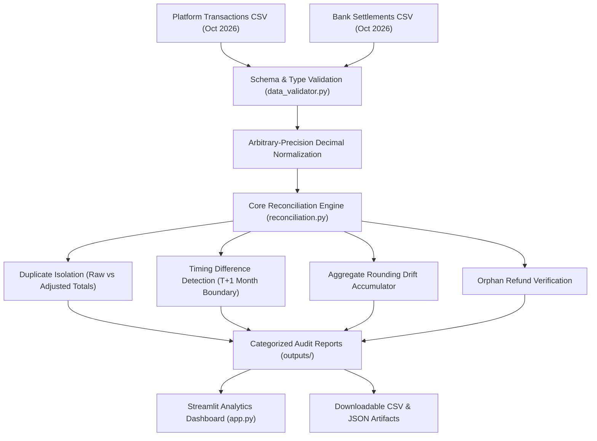

# 💳 Payment Reconciliation & Discrepancy Detection Engine (One Labs Assignment)

[](https://rohan-kumbhar-3387-one-labs-assignment.streamlit.app)
[](https://www.python.org/downloads/)
[](https://github.com/Rohan-Kumbhar-3387/one-labs-assignment)

An end-to-end financial payment reconciliation and discrepancy detection engine built for the **One Labs Assignment**. The application ingests platform transaction logs and bank settlement statements, performs high-precision `Decimal` financial arithmetic, isolates duplicate records, detects cross-month timing differences, uncovers aggregate rounding drift, flags unauthorized/orphan refunds, and serves an interactive Streamlit investigation dashboard.

---

## 🔗 Project Links

- **GitHub Repository**: [https://github.com/Rohan-Kumbhar-3387/one-labs-assignment](https://github.com/Rohan-Kumbhar-3387/one-labs-assignment)
- **Live Streamlit Cloud Deployment**: [https://rohan-kumbhar-3387-one-labs-assignment.streamlit.app](https://rohan-kumbhar-3387-one-labs-assignment.streamlit.app)
- **Local Development Dashboard**: `http://localhost:8501`

---

## 🌟 Architecture & Core Capabilities



### 1. High-Precision Decimal Engine
Eliminates binary IEEE-754 floating-point inaccuracies using Python's native `Decimal` module for all financial operations. Every currency residual and accumulated balance matches down to fractions of a paise/cent.

### 2. Duplicate-Aware Net Positioning
Separates raw ledger counts and volumes from duplicate-adjusted totals. When a transaction ID is settled multiple times in the bank ledger (e.g. `PAY-0060`), secondary settlements are flagged as `Duplicate bank entry` and isolated from the net ledger balance.

### 3. Timing Differences (Cross-Period Settlement)
Transactions executed at month-end (`PAY-0120` on October 31) that settle on November 1 are recognized as in-flight timing differences rather than permanently missing payments, preventing incorrect balance write-offs.

### 4. Aggregate Rounding Detection
Subtle micro-residuals (`+0.004` INR) that pass transaction-level tolerance (`0.005` INR) are tracked across transactions (`PAY-0001` through `PAY-0005`). When cumulative drift reaches the threshold (`0.01` INR), the engine flags an `Aggregate rounding difference` for financial auditor investigation.

### 5. Orphan / Unmatched Refunds
Platform refund `REF-UNMATCHED-001` referencing nonexistent original transaction `PAY-DOES-NOT-EXIST` is flagged specifically as an unauthorized orphan refund, without falsely double-counting it as a missing bank settlement.

---

## 📂 Project Directory Structure

```text
├── .gitignore                          # Standard git ignore definitions
├── .streamlit/
│   └── config.toml                     # Streamlit server and UI theme configuration
├── data/
│   ├── platform_transactions.csv       # 126 synthetic platform transactions (Oct 2026)
│   └── bank_settlements.csv            # 126 synthetic bank settlements
├── docs/
│   ├── architecture.md                 # System architecture and data flow diagram
│   ├── assumptions.md                  # Financial & synthetic dataset assumptions
│   ├── test_cases.md                   # Automated test case documentation
│   ├── production_limitations.txt      # Production limitations (exactly 3 sentences)
│   ├── demo_script.md                  # 2–3 minute video presentation script
│   └── submission_checklist.md         # Phase-by-phase completion checklist
├── outputs/
│   ├── summary.json                    # Machine-readable reconciliation summary
│   ├── discrepancy_report.csv          # Categorized discrepancy log with action advice
│   └── transaction_reconciliation.csv  # Full transaction-level reconciliation table
├── src/
│   ├── __init__.py
│   ├── data_generator.py               # Deterministic dataset generator (seed 20261017)
│   ├── data_validator.py               # Schema validation & Decimal type conversion
│   └── reconciliation.py               # Core matching & discrepancy detection engine
├── tests/
│   └── test_reconciliation.py          # 14 pytest unit & integration test cases
├── app.py                              # Streamlit dashboard application
├── payment_reconciliation_submission.zip # Source code ZIP archive
├── pytest.ini                          # Pytest configuration
├── requirements.txt                    # Project dependencies
└── PROJECT_STATUS.md                   # Real-time incremental phase tracking
```

---

## 🚀 Running the Project Locally

### 1. Prerequisites
- Python 3.10+ (tested on Python 3.13)
- Windows PowerShell, macOS terminal, or Linux bash

### 2. Quick Setup
```powershell
# Navigate to the project root
cd D:\payment_reconciliation_complete

# Install dependencies
pip install -r requirements.txt

# Generate reproducible synthetic datasets
python src/data_generator.py

# Execute the reconciliation engine
python src/reconciliation.py

# Run the full automated test suite
python -m pytest -v

# Launch the interactive Streamlit UI
streamlit run app.py
```
Open **[http://localhost:8501](http://localhost:8501)** in your browser.

---

## 🧪 Automated Test Suite (`pytest`)

All 14 unit and integration test cases pass 100%:
```powershell
python -m pytest -v
```

```text
============================= test session starts =============================
platform win32 -- Python 3.13.5, pytest-9.1.1, pluggy-1.5.0
configfile: pytest.ini
testpaths: tests
collected 14 items

tests/test_reconciliation.py::test_all_four_planted_discrepancies_detected PASSED [  7%]
tests/test_reconciliation.py::test_unmatched_refund_not_double_counted_as_missing_settlement PASSED [ 14%]
tests/test_reconciliation.py::test_duplicate_adjusted_bank_total_excludes_duplicate PASSED [ 21%]
tests/test_reconciliation.py::test_timing_difference_is_not_missing_settlement PASSED [ 28%]
tests/test_reconciliation.py::test_invalid_platform_columns_raise_error PASSED [ 35%]
tests/test_reconciliation.py::test_invalid_bank_columns_raise_error PASSED [ 42%]
tests/test_reconciliation.py::test_invalid_date_format_raises_error PASSED [ 50%]
tests/test_reconciliation.py::test_invalid_amount_raises_error PASSED    [ 57%]
tests/test_reconciliation.py::test_empty_both_datasets_reconcile_cleanly PASSED [ 64%]
tests/test_reconciliation.py::test_missing_settlement_is_detected PASSED [ 71%]
tests/test_reconciliation.py::test_unmatched_bank_entry_is_detected PASSED [ 78%]
tests/test_reconciliation.py::test_amount_mismatch_detected PASSED       [ 85%]
tests/test_reconciliation.py::test_duplicate_platform_entry_detected PASSED [ 92%]
tests/test_reconciliation.py::test_decimal_financial_precision PASSED    [100%]

============================= 14 passed in 1.10s ==============================
```

---

## ☁️ Streamlit Community Cloud Deployment Steps

To complete the public deployment from the `Rohan-Kumbhar-3387` GitHub account:

### Step 1: Create GitHub Repository
1. Log in to [GitHub as Rohan-Kumbhar-3387](https://github.com/Rohan-Kumbhar-3387).
2. Visit [https://github.com/new](https://github.com/new).
3. Set **Repository name** to `one-labs-assignment`.
4. Choose **Public** and do NOT initialize with README (the repository is already prepared locally).
5. Click **Create repository**.

### Step 2: Push Local Code to GitHub
Run the following in PowerShell:
```powershell
cd D:\payment_reconciliation_complete
git push -u origin main
```
*(If prompted by Windows Git Credential Manager, log in with `Rohan-Kumbhar-3387` or use a Personal Access Token with `repo` scope).*

### Step 3: Deploy to Streamlit Community Cloud
1. Go to [share.streamlit.io](https://share.streamlit.io/) and click **Sign in with GitHub**.
2. Authorize using the `Rohan-Kumbhar-3387` account.
3. Click **Create App** > **Deploy a public app from GitHub**.
4. Select:
   - **Repository**: `Rohan-Kumbhar-3387/one-labs-assignment`
   - **Branch**: `main`
   - **Main file path**: `app.py`
   - **App URL**: `rohan-kumbhar-3387-one-labs-assignment` (or customized)
5. Click **Deploy!**. The app will be live at:
   **`https://rohan-kumbhar-3387-one-labs-assignment.streamlit.app`**
