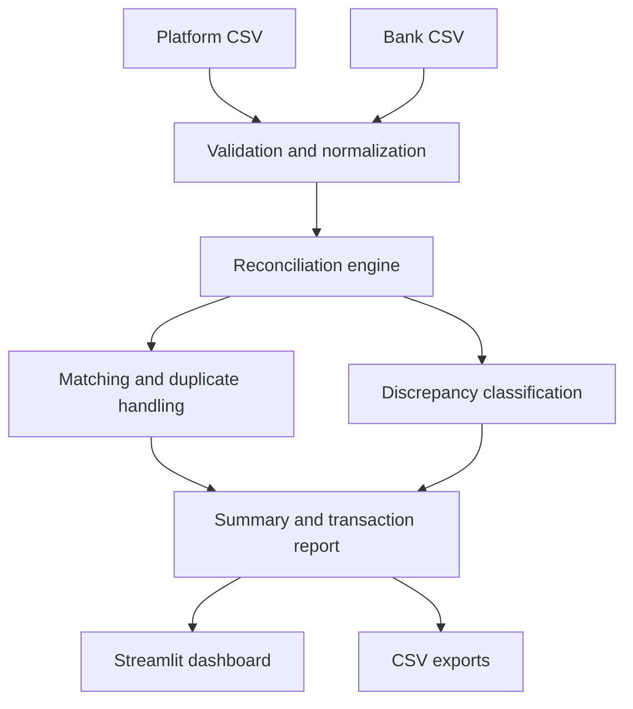

# Architecture

The Streamlit layer handles uploads, presentation, filtering, and downloads. Validation and reconciliation are implemented in independent Python modules so they can be tested without running the UI. Decimal values are retained for all financial comparisons and totals.
